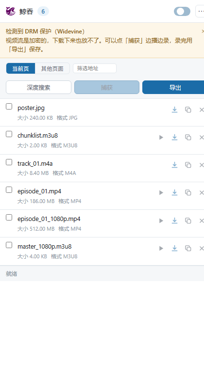
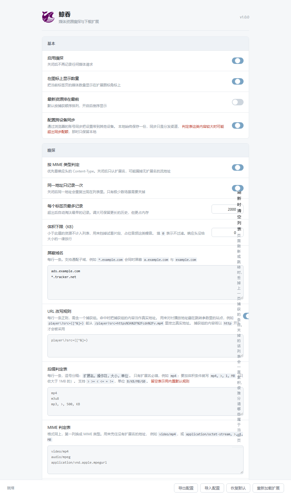

<div align="center">

# Whale Swallow

[](https://github.com/newnju/jingtun/actions/workflows/ci.yml)
[](https://github.com/newnju/jingtun/releases/tag/v1.0.0)
[](LICENSE)

[中文](README.md) · **English**

</div>

A Chrome Manifest V3 extension for detecting and downloading HLS, DASH, and direct media from web pages. It identifies media resources through three channels — `webRequest`, injected page scripts, and MSE capture — parses HLS (m3u8) and DASH (mpd) manifests, downloads and decrypts segments (AES-128), and merges everything locally. All parsing and processing happen on your machine.

Written in plain JavaScript with no build step. The project's own code is MIT licensed; the bundled FFmpeg WebAssembly core is LGPL-2.1-or-later and distributed as a separate, replaceable component — see [THIRD_PARTY_LICENSES.md](THIRD_PARTY_LICENSES.md).

Full usage guide: [docs/USAGE.en.md](docs/USAGE.en.md) ([中文](docs/USAGE.zh-CN.md)).



<details>
<summary>More screenshots</summary>



</details>

## Features

### Sniffing

- Listens to network requests via `webRequest`, recording URL, request/response headers and resource size.
- Injects scripts into the page main world, hooking `fetch`, `XMLHttpRequest` and `JSON.parse`, and recursively into Workers, to find media URLs hidden inside API responses.
- Proxies `MediaSource.addSourceBuffer` to capture `blob:` playback.
- Cleans duplicate container headers, restores the init segment and detects the extension from the byte signature when exporting MSE data.
- Detects Widevine / PlayReady DRM and warns that the content cannot be downloaded directly.

### HLS download

- Auto-detects master and media playlists with multi-bitrate selection.
- 1–16 concurrent connections, slow start, adaptive concurrency, retries, speed / ETA / progress display.
- **Throttle awareness**: when `403/429` responses pile up, concurrency is halved and a cooldown kicks in — so "more parallelism" no longer means "less success".
- **Anti-hotlink headers**: segment requests carry the source page as `Referer` (via `fetch.referrer`); cookies go through `credentials`.
- **Disk-backed resume**: finished segments are cached in the browser's private file system (OPFS); re-running skips them and only fetches what is missing.
- AES-128 decryption, `EXT-X-BYTERANGE` and `EXT-X-MAP` (including multiple init segments).
- Keys are cached per URI and concurrent key fetches are de-duplicated; when no IV is given it is derived from `EXT-X-MEDIA-SEQUENCE`.
- **Live streams**: detects playlists without `EXT-X-ENDLIST`, follows refreshes and downloads as it goes, with optional duration/segment caps, stream-end and long-idle detection, and a report of segments lost when falling behind.
- Low-Latency HLS: `EXT-X-PART` and `EXT-X-PRELOAD-HINT`.
- `EXT-X-MEDIA` alternate audio and subtitle renditions, selectable by language.

### DASH download

- Parses `SegmentTemplate`, `SegmentList` and `SegmentBase`.
- Audio and video tracks can be selected separately.
- The selected track is converted to an equivalent m3u8 and reuses the HLS download path.
- **Multi-Period**: a Representation spanning several Periods is merged into one track with discontinuity markers and per-Period init segments.
- Detects Widevine / PlayReady / FairPlay in `ContentProtection`.

### Playback & download

- Preview m3u8 / mpd in the popup, switch quality, then download.
- Downloads run in an offscreen document and continue after the popup closes.
- Saving goes through the background's `chrome.downloads`: the offscreen document only mints the Blob URL and the background writes the file, avoiding silently dropped downloads on consecutive runs.
- Concurrency scales with measured throughput and is capped per host; the cap grows with the number of hosts.
- Segment memory is released after merging, so large files do not pile up in RAM.
- The management page aggregates resources across tabs with filtering, search and batch operations.
- Copy media URLs from a template, with headers such as `Referer`.

### Recording

- Real-time recording of direct-link video, live streams and WASM players via `captureStream` + `MediaRecorder`.
- Region recording and WebRTC capture.
- Recording re-encodes (lossy) and takes as long as the playback.

### Headers & keys

- Captured `Authorization`, `Cookie`, `Referer` etc. are passed to the parsing, playback and download flows.
- For ordinary files, `declarativeNetRequest` temporarily injects `Referer` and `Origin`.
- When the standard key request fails, an AES key captured from the page is used as a fallback.

### Settings

The options page covers the master switch, badge count, domain blocklist, per-page record cap, filename template, capture memory cap and deep search.

## Install

1. Open `chrome://extensions/`
2. Enable Developer mode
3. Click "Load unpacked" and select this directory

Requires Chrome 111 or newer. Edge and other Chromium browsers work too.

The UI language follows the browser. Chinese environments show "鲸吞", others show "Whale Swallow". To add a language, create a directory under `_locales/` with a `messages.json`.

## Permissions

| Permission | Purpose |
|---|---|
| `webRequest` | Listen to network requests — the first layer of sniffing |
| `storage` | Store settings and the captured resource list |
| `downloads` | Save files to disk |
| `tabs` | Group resources by tab and show counts on the badge |
| `scripting` | Inject the sniffing scripts |
| `webNavigation` | Detect page transitions and clear stale injection state |
| `alarms` | Periodically clean inactive tab caches |
| `offscreen` | Run segment merge tasks in the background |
| `declarativeNetRequest` | Add `Referer` / `Origin` during downloads |
| `contextMenus` | Provide the right-click menu |
| `sidePanel` | Open the extension in the side panel |
| `<all_urls>` | Cover sniffing on any site |

The extension does **not** request unrelated permissions such as `cookies`, `history`, `bookmarks` or `webRequestBlocking`.

## Privacy

No analytics, telemetry or ads, and no data is uploaded to any server run by the developer.

- Settings live in `chrome.storage.local`; enabling config sync also writes to the browser-provided `chrome.storage.sync`.
- Captured resource metadata is kept in `chrome.storage.session` and cleared when the browser restarts.
- Captured `Cookie` / `Authorization` / `Referer` headers are used locally only, for parsing, playback and download.
- MQTT push, aria2 and "send to local" are off by default and only connect after you fill in and enable them.
- Downloading, merging and ffmpeg remuxing all happen locally.

Full details in [PRIVACY.md](PRIVACY.md). Report security issues per [SECURITY.md](SECURITY.md).

## Usage

1. Open a page with video and play it for a few seconds.
2. Click the extension icon and find the target in the list.
3. If the list is empty, click "Deep search" — the extension injects hooks and reloads the page.
4. For `blob:` URLs or DRM warnings, click "Capture", play from the start, then "Export".
5. For m3u8 / mpd, click "Play" or "Download", pick a quality in the detail panel, preview and download.
6. "New tab" in the detail panel moves the current URL to the standalone parser page.

## Project layout

```
manifest.json          MV3 manifest
popup.html/css/js      Popup UI and streaming detail panel
m3u8.html/css/js       M3U8 / MPD parsing and download page
preview.html/css/js    Preview player page
options.html/css/js    Settings page
manage.html/css/js     Resource management page
downloader.html        Standalone download page
offscreen.html         Background task host page
_locales/              UI strings (zh_CN / en)

js/background.js       Service Worker: sniffing, classification, storage, routing, saving
js/content-script.js   Bridge between page and extension
js/offscreen.js        Background download task: parse, fetch, merge, follow live
js/inject/             Capturing scripts injected into the page main world
js/lib/                Utilities, resource classification, storage and config
js/m3u8.js             m3u8 parsing and AES-128 decryption (LL-HLS parts, renditions)
js/live.js             Live playlist loader: follow, dedupe, gap detection, end detection
js/segment-cache.js    Disk resume: OPFS segment cache, job fingerprint, hit validation
js/mpd.js              DASH parsing and m3u8 conversion (multi-Period)
js/downloader.js       Adaptive concurrent downloader: timeout, retry, Range verification
lib/hls.min.js         hls.js 1.5.17 (Apache-2.0)
lib/mqtt.min.js        MQTT.js 5.10.1 (MIT)
lib/qrcode.js          qrcode-generator 1.4.4 (MIT)
lib/ffmpeg/            Local FFmpeg WASM core and build info
LICENSES/              Full third-party license texts
docs/                  README screenshot
tools/                 Check, test and icon-generation scripts
```

## Development

After editing, click reload on the extension management page.

```bash
# Static checks and pure-logic tests
npm test

# Verify the bundled FFmpeg WASM core
npm run test:ffmpeg

# Full suite, including real-browser integration tests
npm run test:full

# Generate standalone UI previews
node tools/make-preview.js

# Regenerate placeholder icons
python tools/gen-icons.py
```

`tools/check.js` validates element ids, message types, resource paths, manifest references, i18n keys and cross-context message chains.

`tools/make-preview.js` reads each page, injects `chrome.*` stubs and inlines local assets, producing preview files you can open directly in a normal browser.

Pure-logic tests need no browser and can be run individually:

```bash
node tools/check.js              # static consistency (15 checks)
node tools/check-messages.js     # message-chain closure
node tools/test-m3u8.js          # m3u8 parsing (LL-HLS, renditions)
node tools/test-mpd.js           # DASH parsing (multi-Period)
node tools/test-downloader.js    # downloader: retry, timeout, Range, concurrency
node tools/test-resume.js        # disk resume: hit, invalidation, partial refill
node tools/test-throttle.js      # throttle awareness and anti-hotlink Referer
node tools/test-live.js          # live loader: dedupe, gaps, end detection
```

`test-downloader.js` uses a programmable `fetch` double to cover network behaviour without going online.

The full suite needs `playwright-core` and Chromium (`PLAYWRIGHT_CORE`, `CHROME_PATH`), plus ffmpeg / ffprobe (`FFMPEG_PATH`, `FFPROBE_PATH`). Test screenshots and media are written to temp directories and should not be committed.

See [CONTRIBUTING.md](CONTRIBUTING.md) for workflow and commit conventions.

## Known limitations

- DRM content cannot be downloaded. Widevine / PlayReady / FairPlay keys live inside the CDM and are not readable from JavaScript.
- `SAMPLE-AES` and `SAMPLE-AES-CTR` streams cannot be downloaded — sample-level decryption needs `moof`/`traf` parsing, unlike whole-segment AES-128. The extension reports this explicitly rather than producing an undecryptable file.
- I-frame-only playlists (`#EXT-X-I-FRAMES-ONLY`, used for scrubbing) have no complete picture and are rejected.
- Delta playlists (`#EXT-X-SKIP`) only carry the last few segments; downloading one alone yields a headless video, which the extension warns about.
- Live DASH (`type="dynamic"`) can only fetch the segments already in the manifest; it cannot follow refreshes like HLS.
- DASH audio and video usually live in separate AdaptationSets and must be downloaded separately, then merged with ffmpeg.
- When MSE capture yields two tracks, both files are exported along with the ffmpeg merge command.
- Recording re-encodes in real time (lossy) and takes as long as the playback.
- Live recording ends when you press stop; `maxDuration` / `maxSegments` can cap it programmatically.
- When a site uses a native HLS player, the extension cannot modify its request headers.
- Keeping deep search always on injects hooks into every page and has a performance cost; it is off by default.

## Disclaimer

This project is for technical research and personal use. It sniffs and downloads media the user is authorized to access.

Users are responsible for complying with local laws and the target site's terms of service. Do not use it to download or redistribute copyrighted content. This project does not provide DRM circumvention. Full text in [NOTICE.md](NOTICE.md).

## Contributing

See [CONTRIBUTING.md](CONTRIBUTING.md) for the dev environment, tests and commit conventions, and [CODE_OF_CONDUCT.md](CODE_OF_CONDUCT.md) for community expectations. Report security issues privately per [SECURITY.md](SECURITY.md).

## License

The project's own code is MIT — see [LICENSE](LICENSE).

The bundled FFmpeg WebAssembly core is LGPL-2.1-or-later, distributed as a separate, replaceable component; build info and source URLs are in [lib/ffmpeg/README.md](lib/ffmpeg/README.md).

Other bundled dependencies: hls.js 1.5.17 (Apache-2.0), mqtt.js 5.10.1 (MIT), qrcode-generator 1.4.4 (MIT). Full component list, copyright notices and license texts are in [THIRD_PARTY_LICENSES.md](THIRD_PARTY_LICENSES.md) and [LICENSES/](LICENSES/).