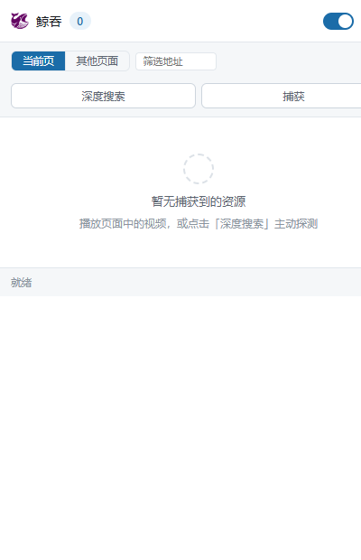

# 鲸吞（Whale Swallow）

基于 Chrome Manifest V3 的媒体嗅探与下载扩展。它通过 webRequest、页面注入脚本和 MSE 捕获三种途径识别网页中的音视频资源，支持 HLS（m3u8）与 DASH（mpd）清单的解析、分片下载、AES-128 解密和本地合并。

A Chrome Manifest V3 extension for detecting and downloading HLS, DASH, and direct media. All parsing and processing happen locally.

项目使用原生 JavaScript，无构建步骤。项目自身代码采用 MIT 许可证；内置的 FFmpeg WebAssembly 核心为 LGPL-2.1-or-later，作为可替换组件单独分发，详见 [THIRD_PARTY_LICENSES.md](THIRD_PARTY_LICENSES.md)。



## 功能

### 资源嗅探

- 使用 webRequest 监听网络请求，记录 URL、请求头、响应头与资源大小。
- 向页面主世界注入脚本，hook fetch、XMLHttpRequest、JSON.parse，并递归注入 Worker，获取接口响应中的媒体地址。
- 代理 MediaSource.addSourceBuffer，捕获 blob: 播放产生的媒体数据。
- 导出 MSE 数据时清理重复的容器头，补回初始化段，并根据字节签名确定扩展名。
- 检测 Widevine、PlayReady 等 DRM 系统，提示内容无法直接下载。

### HLS 下载

- 自动识别主播放列表与媒体播放列表，支持多码率选择。
- 支持 1 至 16 路并发下载、失败重试、进度与速度显示。
- 支持 AES-128 解密、EXT-X-BYTERANGE 和 EXT-X-MAP。
- 密钥按 URI 缓存；清单未提供 IV 时，按 EXT-X-MEDIA-SEQUENCE 推导。

### DASH 下载

- 解析 MPD 中的 SegmentTemplate、SegmentList 和 SegmentBase。
- 音视频轨道可分别选择。
- 选中的轨道会转换为等价的 m3u8，复用 HLS 下载流程。
- 识别 ContentProtection 中的 Widevine、PlayReady 和 FairPlay。

### 播放与下载

- 弹窗内可预览 m3u8 与 mpd，切换画质后直接下载。
- 下载任务由 offscreen document 执行，关闭弹窗后仍会继续。
- 管理页可按标签页查看、筛选、搜索和批量操作资源。
- 支持按模板复制媒体地址，附带 Referer 等请求头。

### 录制

- 对直链视频、直播和 WASM 播放器，可使用 captureStream 与 MediaRecorder 实时录制。
- 支持区域录制与 WebRTC 捕获。
- 录制过程会重新编码，画质有损，耗时与播放时长相同。

### 请求头与密钥

- 嗅探到的 Authorization、Cookie、Referer 等请求头会传给后续的解析、播放和下载流程。
- 下载普通文件时，通过 declarativeNetRequest 临时补充 Referer 与 Origin。
- 标准密钥请求失败时，使用页面中捕获到的 AES 密钥作为后备。

### 设置

设置页提供总开关、图标角标、域名屏蔽、单页记录上限、文件名模板、捕获内存上限和深度搜索等选项。

## 安装

1. 打开 `chrome://extensions/`
2. 开启开发者模式
3. 点击“加载已解压的扩展程序”，选择本项目目录

需要 Chrome 111 或更高版本。Edge 及其他 Chromium 浏览器同样可用。

界面语言跟随浏览器设置。中文环境显示“鲸吞”，其他语言显示“Whale Swallow”。新增语言时，在 `_locales/` 下建立对应目录并添加 `messages.json`。

## 权限

| 权限 | 用途 |
|---|---|
| `webRequest` | 监听网络请求，作为嗅探的第一层 |
| `storage` | 保存设置与捕获到的资源列表 |
| `downloads` | 保存文件到本地 |
| `tabs` | 按标签页归类资源，在图标上显示数量 |
| `scripting` | 向页面注入嗅探脚本 |
| `webNavigation` | 感知页面切换，清理失效的注入状态 |
| `alarms` | 定期清理长期未活动的标签页缓存 |
| `offscreen` | 在后台执行下载分片的合并任务 |
| `declarativeNetRequest` | 下载时补充 Referer 与 Origin |
| `contextMenus` | 提供右键菜单 |
| `sidePanel` | 在侧边栏中打开扩展 |
| `<all_urls>` | 覆盖任意站点的嗅探需求 |

扩展没有申请 `cookies`、`history`、`bookmarks`、`webRequestBlocking` 等与功能无关的权限。

## 隐私

扩展不包含统计、遥测或广告代码，也不向开发者运营的服务器上传数据。

- 设置保存在 `chrome.storage.local`；开启配置同步后会写入浏览器提供的 `chrome.storage.sync`。
- 嗅探到的资源元数据优先保存在 `chrome.storage.session`，浏览器重启后清空。
- 嗅探到的 `Cookie`、`Authorization`、`Referer` 等请求头只在本地用于解析、播放和下载。
- MQTT 推送、aria2 下载和“发送到本地”默认关闭，只有用户填写并启用对应服务后才会连接。
- 下载、合并和 ffmpeg 转封装都在本地完成。

完整说明见 [PRIVACY.md](PRIVACY.md)。安全问题请按 [SECURITY.md](SECURITY.md) 报告。

## 使用

1. 打开包含视频的页面，播放几秒。
2. 点击扩展图标，在资源列表中查找目标。
3. 列表为空时，点击“深度搜索”，扩展会注入 hook 并刷新页面。
4. 地址为 `blob:` 或页面出现 DRM 提示时，点击“捕获”，从头播放，再用“导出”保存捕获到的数据。
5. 地址为 m3u8 或 mpd 时，点击“播放”或“下载”，在详情面板中选择画质、预览并下载。
6. 详情面板中的“新标签页”可以把当前地址转到独立解析页。

## 目录结构

```
manifest.json          MV3 清单
popup.html/css/js      弹窗主界面与流媒体详情面板
m3u8.html/css/js       M3U8/MPD 解析与下载页
preview.html/css/js    预览播放页
options.html/css/js    设置页
manage.html/css/js     资源管理页
downloader.html        独立下载页
offscreen.html         后台任务承载页
_locales/              界面文案（zh_CN / en）

js/background.js       Service Worker：嗅探、判定、存储、消息路由
js/content-script.js   页面与扩展之间的桥接层
js/offscreen.js        后台下载任务：解析清单、下载分片、合并文件
js/inject/             注入页面主世界的捕获脚本
js/lib/                工具函数、资源判定、存储与配置
js/m3u8.js             m3u8 解析与 AES-128 解密
js/mpd.js              DASH 解析与 m3u8 转换
js/downloader.js       多线程分片下载器
lib/hls.min.js         hls.js 1.5.17（Apache-2.0）
lib/mqtt.min.js        MQTT.js 5.10.1（MIT）
lib/qrcode.js          qrcode-generator 1.4.4（MIT）
lib/ffmpeg/            本地 FFmpeg WASM 核心与构建信息
LICENSES/              第三方许可证全文
docs/                  README 截图
tools/                 检查、测试与图标生成脚本
```

## 开发

修改源码后，在扩展管理页点击刷新即可生效。

```bash
# 静态检查与纯逻辑测试
npm test

# 验证内置 FFmpeg WASM 核心
npm run test:ffmpeg

# 完整测试，包括真实浏览器集成测试
npm run test:full

# 单独生成界面预览
node tools/make-preview.js

# 重新生成占位图标
python tools/gen-icons.py
```

`tools/check.js` 检查元素 id、消息类型、资源路径、manifest 引用、多语言键以及跨环境消息链路。

`tools/make-preview.js` 会读取各页面，插入 `chrome.*` 桩代码并内联本地资源，生成可直接用普通浏览器打开的预览文件。

完整测试需要 `playwright-core` 与 Chromium，可通过 `PLAYWRIGHT_CORE`、`CHROME_PATH` 指定路径；ffmpeg 与 ffprobe 可通过 `FFMPEG_PATH`、`FFPROBE_PATH` 指定。测试产生的截图和媒体文件只写入临时目录，不应提交到仓库。

开发与提交规范见 [CONTRIBUTING.md](CONTRIBUTING.md)。

## 已知限制

- DRM 内容无法下载。Widevine、PlayReady、FairPlay 的解密密钥保存在 CDM 内部，JavaScript 无法读取。
- DASH 的音视频通常位于不同的 AdaptationSet，需要分别下载，再用 ffmpeg 合并。
- MSE 捕获到音视频双轨时，扩展会分别导出两个文件，并给出合并命令。
- 录制模式会实时重新编码，画质有损，且录制耗时与播放时长相同。
- 直播流没有终点，无法合并为单个文件，只能边播边录。
- 浏览器使用原生 HLS 播放器时，扩展无法修改其请求头。
- 常开深度搜索会为每个页面注入 hook，存在性能开销，默认关闭。

## 免责声明

本项目用于技术研究与个人使用，功能是嗅探并下载用户有权访问的网络媒体资源。

使用者应自行确保其行为符合当地法律法规以及目标网站的服务条款。请勿用于下载或传播受版权保护的内容。本项目不提供 DRM 绕过功能。完整说明见 [NOTICE.md](NOTICE.md)。

## 参与

开发环境、测试方式和提交规范见 [CONTRIBUTING.md](CONTRIBUTING.md)。参与讨论时请遵守 [CODE_OF_CONDUCT.md](CODE_OF_CONDUCT.md)。安全问题请按 [SECURITY.md](SECURITY.md) 的流程私下报告。

## 许可证

项目自身代码采用 MIT 许可证，见 [LICENSE](LICENSE)。

内置的 FFmpeg WebAssembly 核心采用 LGPL-2.1-or-later，作为独立、可替换的组件分发；构建信息与源码地址见 [lib/ffmpeg/README.md](lib/ffmpeg/README.md)。

其他第三方依赖：hls.js 1.5.17（Apache-2.0）、mqtt.js 5.10.1（MIT）、qrcode-generator 1.4.4（MIT）。完整组件清单、版权声明和许可证全文见 [THIRD_PARTY_LICENSES.md](THIRD_PARTY_LICENSES.md) 与 [LICENSES/](LICENSES/)。
